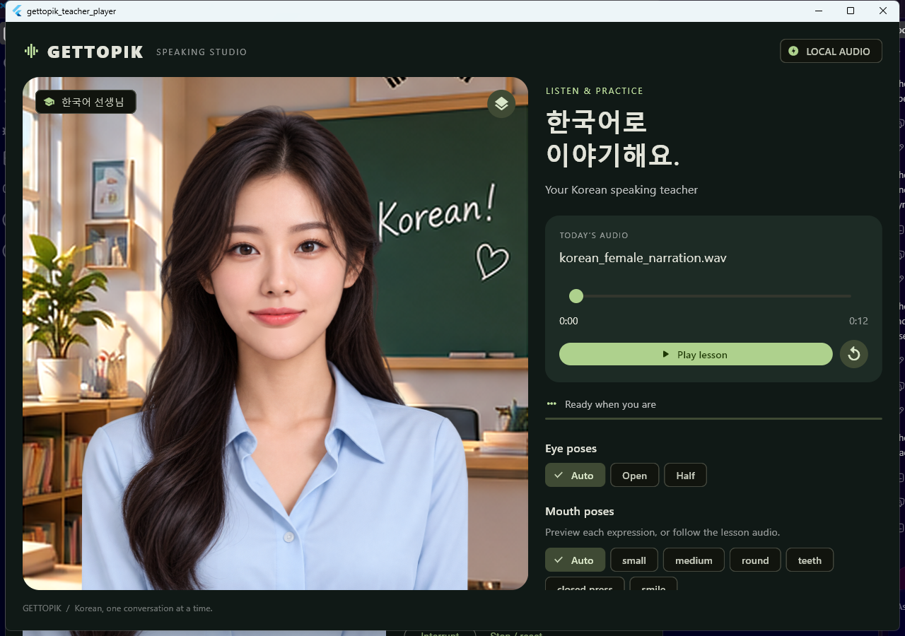
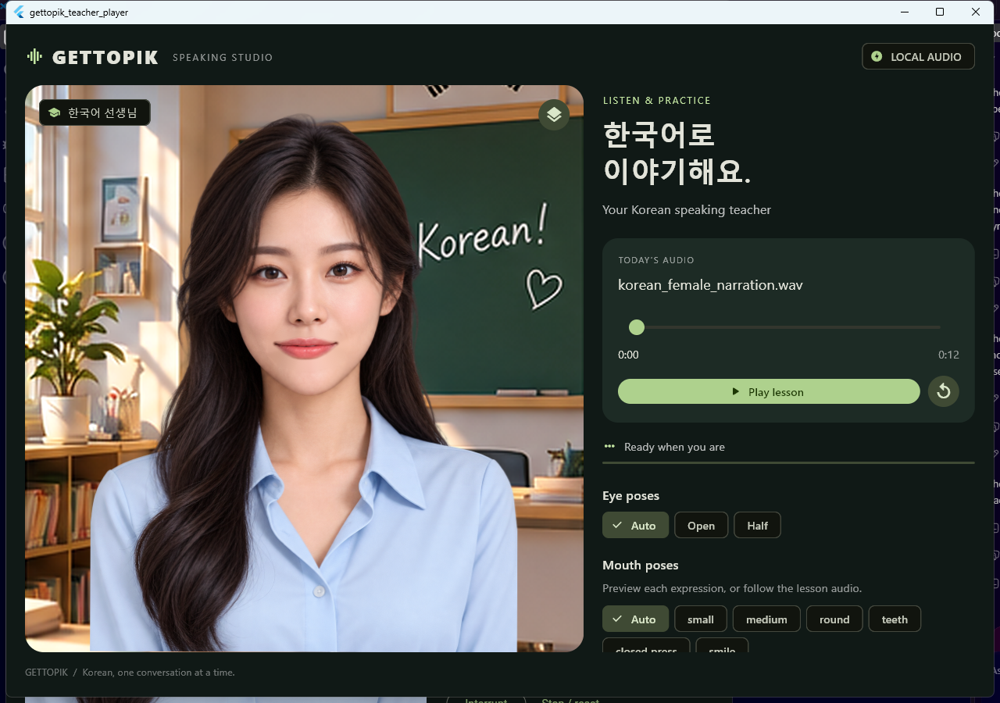
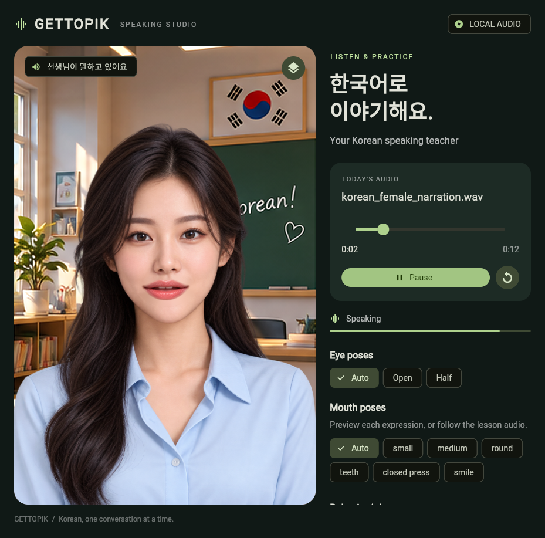

# Adaptive avatar implementation

The existing Teacher rig and studio UI remain in place. A collapsed **Behavior lab** adds local streaming simulation, expression controls and conversation-state controls. The bundled recording is now a [12.12-second Korean female solo narration](AUDIO_SOURCE.md).

## Implemented

- Offline WAV playback retains Play/Pause, seek, completion, replay and audio-position sampling.
- Local streaming simulation feeds real PCM16 audio in 40 ms chunks with small arrival-time variation. Scheduling uses absolute deadlines to avoid accumulated timer drift.
- The streaming avatar samples SoLoud's **consumed sample cursor**, rather than estimated wall time. Explicit pause freezes both local production and playback.
- Audio queued ahead is capped at 480 ms. Producers receive backpressure and must retry; accepted samples are not intentionally dropped. Played samples are released, analysis history is trimmed, and future viseme events have a bounded queue.
- Interruption cancels the old producer and stream, resets animation to Closed press, and invalidates stale turn IDs.
- Korean phone-to-viseme mapping supports neutral, A, E/I, O, U and M/B/P closures. Unknown phones fall back to RMS. Alignment requires ordered, non-overlapping intervals, provenance and an exact audio checksum.
- RMS fallback uses 20 ms windows, attack/release smoothing, silence detection, hysteresis and a minimum pose hold. Local playback uses the recording's measured RMS reference; unknown external streams use a causal peak follower.
- Neutral, Smile, Happy, Encouraging and Soft laugh controls blend independently of speech. Speech articulation and silence retain priority. Soft laugh releases automatically.
- Idle, Listening, Thinking, Speaking, Smiling and Laughing states share one behavior controller. Listening and Thinking expose state and intent without inventing new facial artwork.
- Expression motion adds at most 0.12 degrees of shared tilt, a small positive nod represented by a 2D vertical offset, and a tiny laugh bob. Existing Open/Half blinking, neck-pivot sway and breathing remain active. The classroom stays fixed.
- `CharacterProfile` centralizes artboard and property names, artwork paths, viseme mappings, eye mappings, facial anchors, motion amplitudes and supported capabilities. No additional characters were created.

## Current limitations

**The bundled recording still uses RMS animation, not verified Korean phoneme alignment.** Its publisher transcript is supplied, but no genuine phone-level TextGrid has been produced. The implementation does not spread transcript characters across guessed timestamps. Round and Teeth are available manually and through verified viseme events; RMS alone does not identify vowels.

The [alignment importer](../gettopik-teacher/tools/import_phone_alignment.py) accepts an actual long-format TextGrid with phone and word tiers, checks the word tier against the transcript, and writes a hash-bound viseme JSON. It requires an external offline aligner and its Korean model/dictionary. [MFA publishes a Korean acoustic model](https://mfa-models.readthedocs.io/en/latest/acoustic/Korean/) and [Korean pronunciation dictionary](https://mfa-models.readthedocs.io/en/latest/dictionary/Korean/Korean%20MFA%20dictionary%20v3_0_0.html). No MFA/Conda installation was available in this environment; no phoneme timing is claimed. The default optional path is `player/assets/korean_visemes.json`; the existing `assets/` directory declaration includes that file when supplied. A missing or invalid alignment leaves the explicit RMS fallback label visible.

Automatic emotion or laughter recognition from arbitrary audio is **not implemented**. Expressions are controlled manually or by external events. Smile and speech coexist as controller layers, but the existing images do not contain open smiling vowel variants: articulation takes priority and the Smile image is used during weak voiced openings or idle. O and U share Round; E/I share subtle Teeth. No new eye art or facial deformation was introduced.

Whole-avatar sway remains the existing fallback because the head artwork includes shoulders. This is a flat PNG rig, so the positive nod is a small 2D gesture rather than a 3D head nod. Mobile platforms have not been run or benchmarked.

## Controller integration

```dart
controller.onListening();
controller.onThinking();
controller.onSpeaking();
controller.setEmotion(AvatarEmotion.encouraging);
controller.resetEmotion();
controller.onIdle();
await controller.onSpeechInterrupted();

// Real-time adapter contract: PCM16 little-endian, mono, fixed sample rate.
final turn = await controller.startPcmStream(sampleRate: 24000);
final result = controller.addPcmChunk(turn, pcmBytes);
// On backpressure, retain pcmBytes and retry after the queue drains.
// On staleTurn, discard data belonging to the interrupted response.
controller.finishPcmStream(turn);
```

For externally verified timing, call `addStreamingVisemes(turn, events)` with event times relative to the start of that PCM turn. The stream accepts at most 256 pending events within a two-second horizon. Use `pause`, `resume`, `stop` and `onSpeechInterrupted` to manage lifecycle. No Gemini, WebSocket or backend connection is included.

## Verification

Run from `player/`:

```powershell
flutter analyze
flutter test test/avatar_engine_test.dart
flutter test integration_test/playback_test.dart -d windows
flutter test integration_test/adaptive_test.dart -d windows
flutter run -d chrome --web-hostname=127.0.0.1 --web-port=7357
```

The native tests exercise actual audio output using speaker loopback, not just animation timers. Run the two Windows integration files as separate commands: the directory-wide runner failed to attach its second debug session on this machine, while the individual runs passed. Generated captures and curated JSON measurements are under `gettopik-teacher/validation/adaptive/`. Measurements describe this Windows debug test machine and exclude unmeasured speaker/display hardware latency. See the current JSON reports for exact sample counts and timings.

## Files

| Area | Sources |
| --- | --- |
| Reusable behavior and mapping | `player/lib/avatar/{behavior,character_profile,lip_sync}.dart` |
| Streaming PCM and WAV parsing | `player/lib/audio/{pcm_stream_player,pcm_wav}.dart` |
| Integration and controls | `player/lib/avatar_controller.dart`, `behavior_lab.dart`, `main.dart` |
| Rive expression binding | `gettopik-teacher/tools/expression_rig.py`, `build_scene.py`, `head_motion_rig.py`, `scene.rml` |
| Audio and alignment tooling | `prepare_fleurs_demo.py`, `analyze_audio.py`, `import_phone_alignment.py` |
| Tests | `player/test/avatar_engine_test.dart`, `player/integration_test/{playback,adaptive}_test.dart` |
| Bundled output | `player/assets/teacher.riv`, `korean_demo.wav`, `mouth_timeline.json` |

## Recorded results

- Rive verify/build: zero errors and warnings; inspection reports no problems.
- Flutter analysis: no issues. Seven engine tests pass. Native offline and adaptive playback tests pass when run individually.
- Native streaming first chunk to observed consumed cursor: **116.933 ms**; maximum queued audio: **208.000 ms**, with **0 underruns** in the sampled window.
- Analysis-frame age relative to the consumed cursor: at most **9.334 ms** in this run, sampled by a 20 ms poll. This is not an end-to-end acoustic lip-sync measurement.
- Windows debug frame timings (727 samples): widget build p50 1.330 ms / p95 24.438 ms; raster p50 1.506 ms / p95 2.788 ms. No fixed frame-rate guarantee is made.
- Chrome Web: offline playback, PCM streaming, Smile during playback, pause/resume and interruption exercised. Streaming speaker output detected; no runtime exceptions during the browser test. The Web UI reported approximately 181 ms startup in that run.
- All pre-existing non-audio Rive timelines, including Open/Half blinking and idle motion, are semantically unchanged. Scene regeneration reproduces the checked-in RML exactly.
- All 15 tracked source PNGs are byte-for-byte unchanged. Bundled Rive, WAV and timeline copies match their source outputs.

| Native Smile | Native Soft laugh |
| --- | --- |
|  |  |



Evidence: [adaptive measurements](../gettopik-teacher/validation/adaptive/adaptive-report.json), [offline playback](../gettopik-teacher/validation/adaptive/offline-report.json), [browser checks](../gettopik-teacher/validation/adaptive/web-report.json), [artwork preservation](../gettopik-teacher/validation/adaptive/preservation-report.json).
