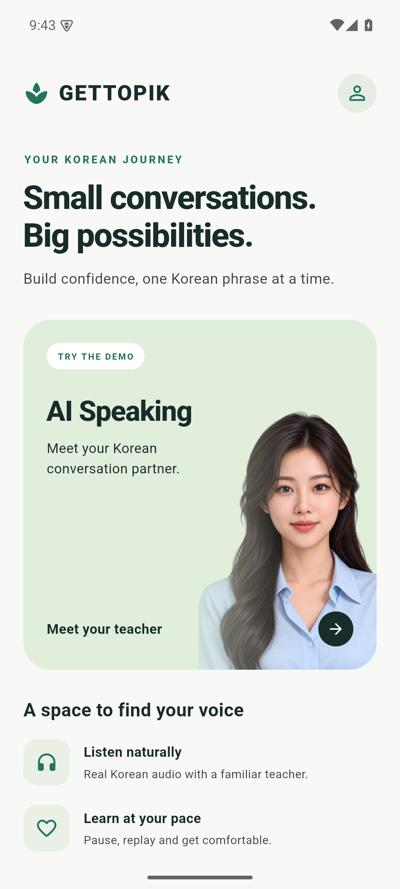
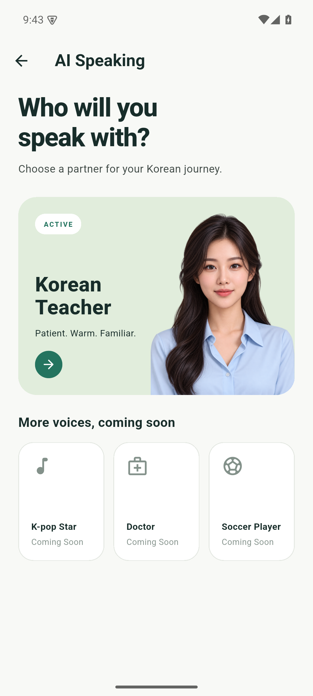
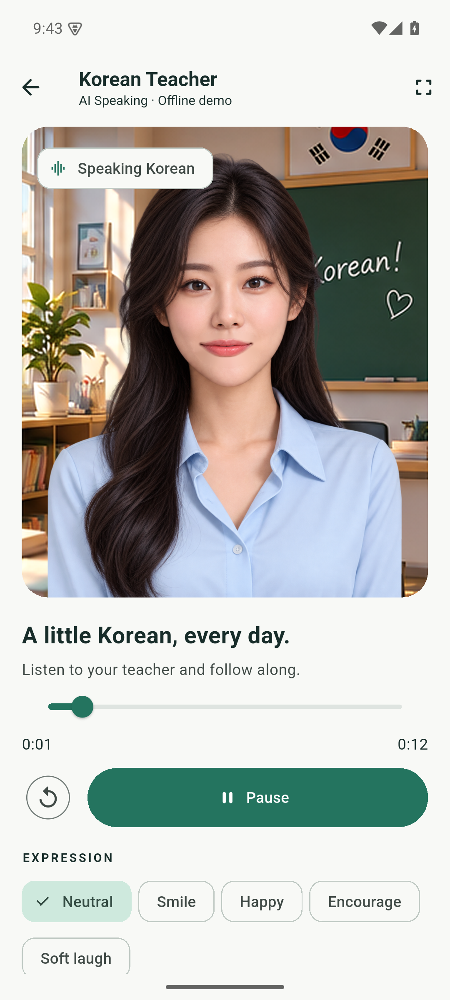
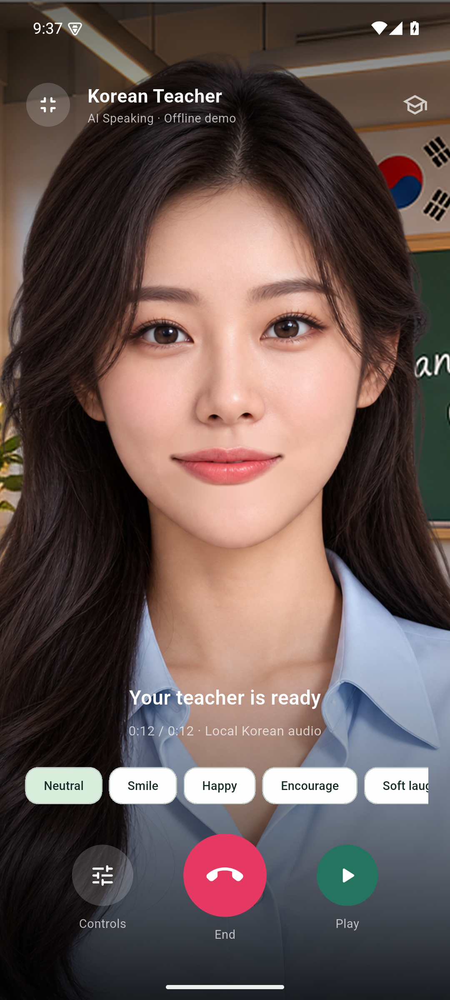
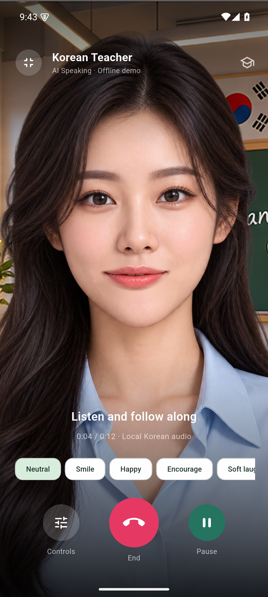

# GETTOPIK Android speaking demo

The mobile host has three screens: Home → Character selection → Korean Teacher.
Only the Teacher is enabled. The other cards use Material icons and are marked
Coming Soon. The portrait on the first two screens is a byte-for-byte copy of
the existing `teacher_original.png`; no new character artwork is generated.

| Home | Character selection | Teacher studio |
| --- | --- | --- |
|  |  |  |

| Full-screen call view | Playing in full screen |
| --- | --- |
|  |  |

## Run

Requires Flutter 3.44.6 / Dart 3.12.2, Java compatible with Gradle 9.1, Android SDK
36, NDK 28.2.13676358, and a running Android emulator or connected Android device.
The first build downloads native dependencies. Playback after installation is
offline and does not need microphone access, credentials or a backend.

From `player/`:

```powershell
flutter pub get
flutter devices
flutter run -d emulator-5554 -t lib/main_mobile.dart
```

`main.dart` also selects this host automatically on Android. Windows and Web
retain the existing Speaking Studio. To preview the mobile host on another
platform, explicitly pass `-t lib/main_mobile.dart`.

```powershell
flutter build apk --debug -t lib/main_mobile.dart --target-platform android-x64
# Physical Android device: measure performance in profile mode.
flutter run --profile -t lib/main_mobile.dart -d YOUR_PHYSICAL_DEVICE_ID
```

The debug APK is `player/build/app/outputs/flutter-apk/app-debug.apk`. The
generated release configuration currently uses the local debug signing key;
set up your own release signing before distribution. This is a standalone
test app, not a Play Store release.

The current local artifact is also copied to
`dist/GETTOPIK-Android/gettopik-demo-debug-x86_64.apk` (ignored build output).
Its measured size is **127,478,158 bytes / 121.57 MiB**. This debug emulator APK
includes debug kernel data and native plugin libraries; it is not a release-size
benchmark. Rebuild for an ARM physical device using Flutter instead of installing
this x86_64 artifact there.

## Controls and lifecycle

Play/Pause, restart and seeking use the existing unified SoLoud PCM16 engine.
The default is B, the conservative Lightweight DSP policy. Expressions remain
independent of speech. Expand Avatar test controls for manual safe mouth poses,
Auto/Open/Half eyes, the local WAV/PCM stream producers and interruption.
Rest, Wide and Closed eyes remain excluded.

Backgrounding or losing application focus pauses playback and suspends the
presentation and local producer timers. Returning resumes idle visuals only;
press Play to continue audio. Back disposes the screen's controller, stream
source, timers and Rive objects. The shared audio backend remains initialized
for later visits. Slider dragging commits one seek on release.

The stage uses the original transparent Rive avatar and a separate classroom
image, so the background does not rotate. Motion, breathing, eyes, photographic
mouth states and emotion properties use the existing rig. DSP estimates speech
energy and rough noise-like features, not phonemes. No Gemini connection or
recognition model is included.

Tap the full-screen icon in the Teacher header for the video-call-style view.
The Teacher fills the screen using proportional cropping, with an overlaid
title, expressions, Controls, a central End button and Play/Pause. Controls or
Android Back returns to the studio. Switching views keeps the same controller,
Rive surface and audio cursor; it does not reload the character or restart audio.
Breathing gain accounts for the larger cover scale so it stays subtle. This is
an offline audio demonstration; no live connection or microphone is implied.
Landscape contains the complete Teacher instead of cropping off her face.

## Transfer into the GETTOPIK Flutter app

The feature entry point is `lib/features/ai_speaking/ai_speaking.dart`. It exports
`AiSpeakingScreen`, `TeacherAvatarView` and the existing `AvatarController`.
The feature imports neither `main.dart` nor `lib/demo/`, and uses its host's
Material theme. Navigation is supplied through an `onClose` callback:

```dart
AiSpeakingScreen(
  onClose: () => Navigator.of(context).pop(),
  onController: (controller) {
    // Optional host access. Wait for controller.ready before sending audio.
  },
)
```

Copy `lib/features/ai_speaking/`, `lib/avatar_controller.dart`, `lib/avatar/`,
`lib/audio/` and the runtime assets from `player/assets/`. Add the pinned Rive,
flutter_soloud and crypto dependencies and bundle entries from `pubspec.yaml`.
Initialize `RiveNative.init()` once in the host. The screen owns and disposes
its controller. For a custom screen, use `TeacherAvatarView` with a host-owned
controller and forward lifecycle events to `suspendPresentation()` and
`resumePresentation()`.

`startPcmStream`, `addPcmChunk`, `finishPcmStream`, turn IDs, backpressure and
optional trusted viseme events remain available for a future transport adapter.
That adapter and the app's microphone/session/network handling are not included.

## Reproduce preliminary emulator measurements

In one terminal at the repository root:

```powershell
python tools/measure-android.py --serial emulator-5554 --test-log staging/android-session.txt
```

Then, in `player/`:

```powershell
flutter test integration_test/mobile_test.dart -d emulator-5554 --dart-define=AVATAR_PROBE=true *> ../staging/android-session.txt
```

The companion adb collector must run for the real HOME/foreground transition.
Create the root `staging/` directory first and choose a fresh log filename for
each run. Flutter integration-test print output travels through the test runner,
so the collector follows that file; ordinary instrumented app runs can instead
be observed directly through adb logcat by omitting `--test-log`.
It captures screenshots at test markers and samples Android PSS and process
CPU ticks every ten seconds during five minutes of repeated real playback.
Flutter instrumentation retains the most recent 600 frame samples and emits
five-second diagnostics only when `AVATAR_PROBE=true`. Normal builds do not
register that instrumentation.

Evidence goes to `docs/measurements/android/` and `docs/images/android/`.
CPU is reported as a percentage of one logical core from `/proc` ticks and
measured wall time, when Android permits access. PSS is from `dumpsys meminfo`.
The 16.67 ms frame threshold assumes the emulator's 60 Hz display; the recorded
Flutter build/raster timings do not represent complete display presentation
latency. Android gfxinfo is supplemental and may not account for Flutter's
rendering work.

Emulator debug results are preliminary diagnostics. GPU emulation, host load,
instrumentation and debug compilation affect them. Run Flutter profile/release
benchmarks on a physical Android device before making mobile performance claims.
The audio cursor metrics exclude speaker/display hardware latency; speaker
loopback checks output, not phoneme accuracy.

## Measured emulator results — 23 October 2026

Android 15 / API 35, Pixel 7 AVD, x86_64, 4 vCPUs, 4,096 MiB configured RAM,
1080 × 2400 at 420 dpi, 60 Hz. Emulator 37.2.12, WHPX, NVIDIA TITAN RTX host
graphics. Flutter 3.44.6 / Dart 3.12.2, **debug**, fully live integration-test
rendering and opt-in probes. Host: Windows 11, i9-9900K, 32 GiB RAM.

The windowed emulator encountered an OpenGL context error. The completed
measurement run used `-no-window` with host GPU acceleration. The interactive
preview subsequently uses headless SwiftShader / Vulkan disabled plus a
[scrcpy](https://github.com/Genymobile/scrcpy/releases/tag/v5.0.1) window to avoid
that display path. Preview performance differs from the measured host-GPU run;
mirroring was started after measurements finished.

| Measurement | Observed value |
| --- | --- |
| Session | 300.022 seconds; 25 starts, 24 complete playbacks |
| Android PSS | 299.8 → 311.3 MiB; +11.5 MiB; peak 323.0 MiB |
| CPU | 51.3% weighted mean of one logical core; median 50.8% |
| Flutter build time, final 600-frame window | p50 3.05 ms; p95 10.39 ms |
| Flutter raster time, same window | p50 4.64 ms; p95 16.86 ms |
| Frame timing overruns | 975 / 17,175 frames, 5.68%; either stage >16.67 ms |
| First installed debug launch | Android cold-start TotalTime 4,673 ms |
| Final APK, process-cold launches with warm caches | 4,176 / 4,180 / 4,184 ms; SwiftShader + mirroring |
| First Teacher load | Rive asset decode 394.65 ms; controller ready 754.43 ms |
| Five reopenings | Ready median 263.24 ms; range 247.11–392.24 ms |
| Warm local WAV request → observed playback cursor | Median 25.71 ms; 22.13–32.27 ms |
| Simulated arriving PCM request → observed cursor | Median 142.23 ms; 140.86–163.47 ms |
| First local Play, including backend initialization | 141.88 ms |
| Selected analysis frame age at consumed cursor | Maximum 9.334 ms; cursor polling 20 ms |
| PCM underruns | 0 across the measured session |
| PCM queue | Maximum 480 ms; bounded by existing backpressure |
| Host speaker loopback | Output detected in 91 / 140 blocks over 14 seconds |

Raw data: [summary](measurements/android/summary.json),
[complete samples](measurements/android/emulator-report.json),
[toolchain and initial startup](measurements/android/setup.json),
[final APK and startup trials](measurements/android/final-apk.json).

The frame counters cover the final controller's lifetime, including a short
warm-up before the session, ending at the last periodic sample. These are
Flutter build/raster budget overruns, not measured end-to-end display jank.
Android `gfxinfo` saw only two native container frames and cannot describe the
avatar's Flutter rendering; its 100% figure is excluded from the Flutter rate.
The PSS trend is one five-minute debug observation and does not prove the absence
of leaks. No hardware audiovisual offset or phoneme accuracy was measured.

Validated: real audio output, playback-clock mouth states 6/1/2, silence closure,
pause/resume, seeking, five emotions, unchanged Auto/Open/Half eyes, actual
HOME/foreground lifecycle and five close/reopen cycles. A separate Android
`fullscreen_test.dart` verifies view switching during playback, unchanged Rive
controller, breathing compensation, full-screen expressions, pause/resume,
Back and End. The five-minute measurements above describe the standard studio
view; a five-minute full-screen performance run has not been performed.

`flutter analyze`, 13 Flutter tests, the Android integration tests and a Windows
streaming regression passed. The Web release build also passed. Rive CLI verify
reported zero errors/warnings, and the compiled `.riv` and existing eye artwork
remain unchanged. The current pinned `rive_native` plugin emits a legacy Kotlin
Gradle compatibility warning under AGP 9; the generated compatibility flags are
retained. Physical-device profile/release benchmarking remains required.
