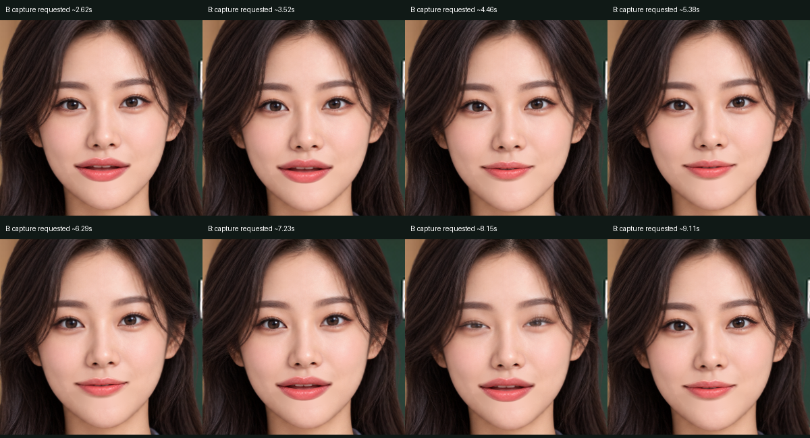
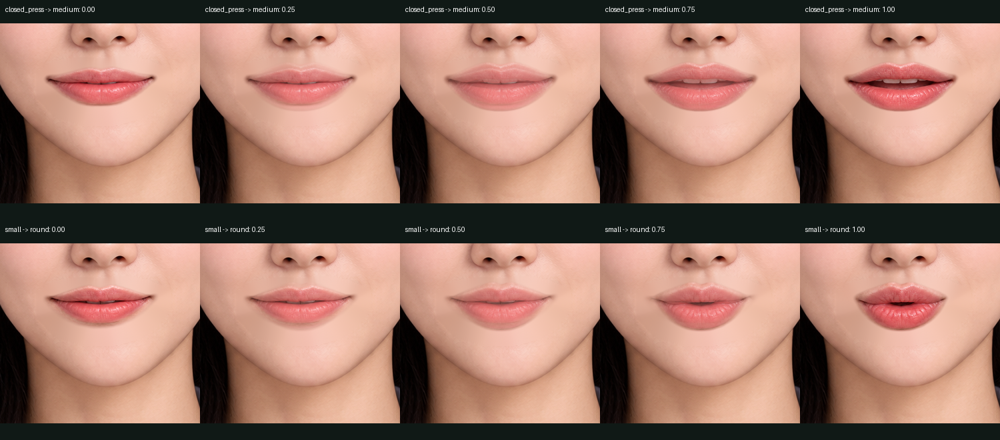
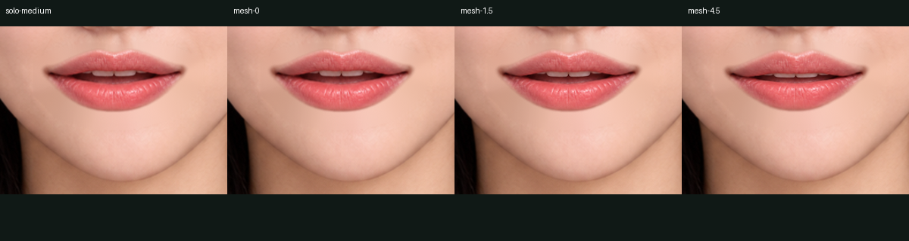
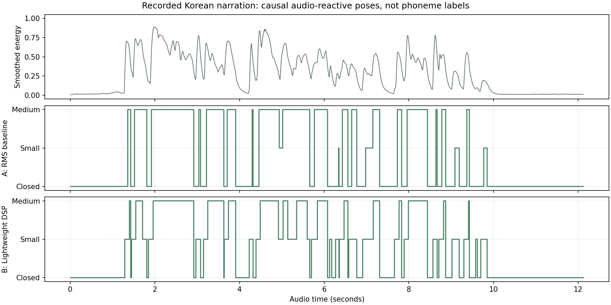
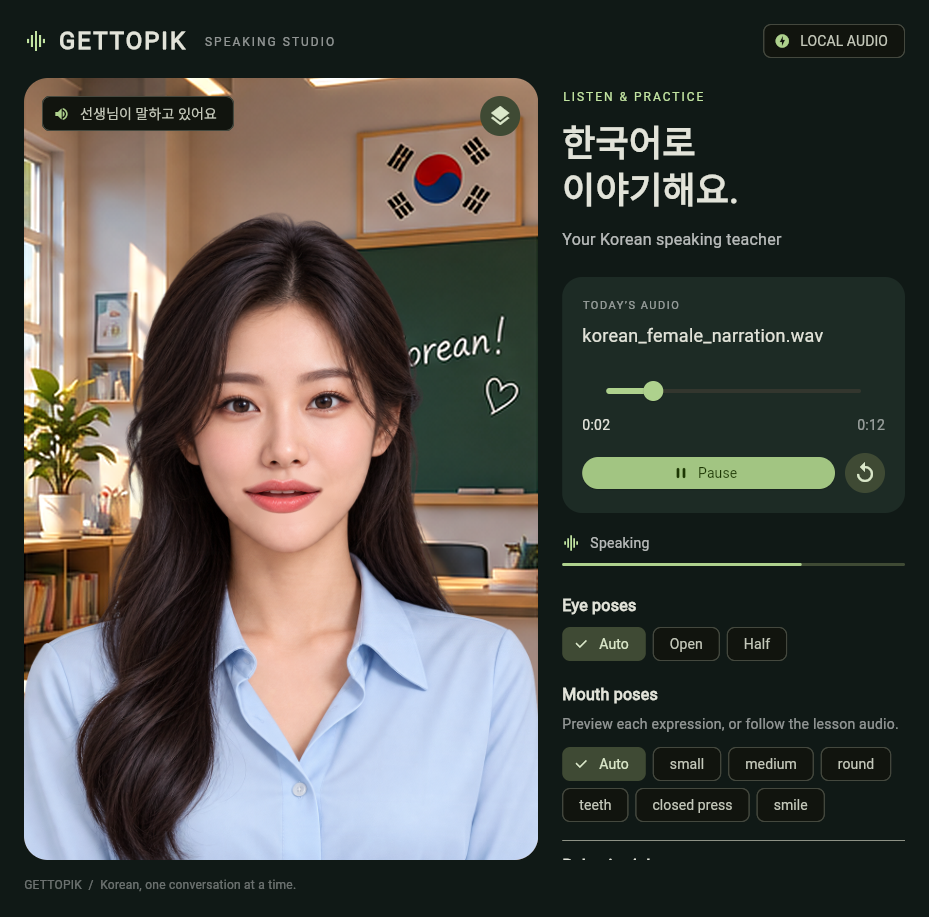

# Teacher mouth quality and PCM playback

The shipped configuration is **B: Lightweight DSP**, using the existing Teacher artwork and `mouthIndex`. It improves speech onset and avoids photographic crossfade artifacts. It does not recognize Korean phonemes. No recognition model, Gemini connection or backend was added.



## What changed

The old 45 ms opacity transitions simultaneously drew two mouth contours and partially revealed the erased-mouth skin foundation. This produced pale lips and ghost outlines, especially for Small ↔ Round. Rive's native `Solo` now selects exactly one opaque mouth image. The controller supplies a restrained Small opening before Medium and uses a 100 ms heuristic dwell; silence closes immediately. Verified timed events bypass that dwell.



The seven mouth/foundation textures formerly each used a 1086 × 1448 canvas. Derived runtime crops preserve every visible pixel, alpha and the original position. All original PNGs, eye assets and existing eye/head/breathing timelines remain unchanged. Mouth decoded RGBA storage falls from **41.99 MiB to 0.66 MiB**; this is a texture-size calculation, separate from measured process memory. The compiled `.riv` falls from 7,319,407 to 5,647,174 bytes.

The generator and baked `AudioMouth` timeline use `Solo` consistently. Existing mouth indices, manual pose controls and disabled Rest/Wide/Closed eyes are preserved.

## Artwork contract

| Shape | Index / existing asset | Use |
| --- | --- | --- |
| Neutral / closed | 6 · Closed press | Same safest artwork for both; silence, pause, completion and interruption |
| Transitional / narrow opening | 1 · Small | Speech onset, restrained articulation, safe E/I substitute |
| Open | 2 · Medium | Largest automatic opening; A-like approximation |
| Rounded | 4 · Round | Manual preview or trustworthy O/U timing; one shared O/U image |
| Spread | 5 · Teeth | Tooth-bearing spread/smile; **not** a neutral E/I vowel |
| Smile | 7 · Smile | Expression control, not a phoneme |

These are artwork descriptions, not proof of phonetic accuracy. `CharacterProfile.shapes` separates them from `Viseme` mappings. The supplied images do not justify distinct O versus U, neutral versus bilabial closure, or independent smiling vowel shapes.

## Mesh experiment

An isolated official Rive mesh used eight fixed boundary vertices, two interior vertices and ten triangles. It compiled and rendered at 0, 1.5 and 4.5 source-pixel interior displacements. Small compression changed the cavity slightly; larger compression flattened lip highlights and retained the existing teeth. It could not produce convincing closed or rounded topology from that open bitmap. **No mesh is shipped.** The prototype can be reproduced with `tools/prepare_mesh_probe.py` and stays under ignored `staging/`.



## One playback engine

Local WAV, simulated incoming chunks and future external PCM all use `PcmStreamPlayer` / SoLoud. The separate `audioplayers` engine and dependency were removed. Local WAV fills the same bounded queue eagerly; simulation introduces small arrival-time variation. All modes use the consumed sample cursor to select mouth states.

- Mono PCM16, little-endian; the demo uses 24 kHz.
- 20 ms trailing analysis, 10 ms hop, 20 ms playback-cursor poll.
- 160 ms prebuffer for arriving chunks; at most 480 ms queued ahead.
- Causal normalization for local and external audio, without reading future samples for estimation.
- Playback-clock pause/resume, seek by opening a new local stream, and stale-turn rejection after interruption.
- Hash-bound optional recorded visemes, or ordered future viseme events within the existing bounded queue. Out-of-range recorded alignment is rejected.

The old 60 fps JSON and Rive `AudioMouth` clip remain available as authoring/reference artifacts. The Flutter live estimator does not depend on their precomputed mouth choices.

## A/B/C comparison

A uses the earlier RMS decision policy and pre-change `.riv`; B uses the current rig and conservative DSP policy. Both comparisons use the same PCM transport, recording, causal normalization and normal app layout. The live A/B buttons compare decision policies on the new rig; the resource benchmark A additionally loads the pre-change rig from a temporary asset. Each native case ran in a fresh process. No screenshot capture ran during the CPU sampling window.

| Windows integration **debug** measurement | A: RMS / original rig | B: DSP / current rig |
| --- | ---: | ---: |
| First chunk → observed playback cursor | 141.5 ms | 137.9 ms |
| Maximum queued audio | 226.7 ms | 226.7 ms |
| Underruns | 0 | 0 |
| Maximum analysis-frame age at cursor | 9.334 ms | 9.334 ms |
| Peak sampled process RSS | 411.0 MiB | 377.4 MiB |
| Process CPU, percent of one core | 45.4% | 45.8% |
| Widget build p95 | 19.111 ms | 18.745 ms |
| Raster p95 | 1.665 ms | 1.694 ms |

RSS was approximately 33.7 MiB lower in the final B run; repeated measurements varied. CPU is effectively unchanged at app level. These include Flutter debug, GPU/resource and UI overhead and are **not mobile or release benchmarks**. Widget build p95 exceeds a 16.7 ms frame budget in both debug cases, so no fixed frame-rate guarantee is made. No speaker/display hardware latency or phoneme accuracy score was measured. External screenshots have approximate capture-request times and serve as appearance evidence.

The pure Dart analysis benchmark processed 606 audio seconds per mode after warm-up. RMS took 0.244 ms per audio second; DSP took 2.146 ms per audio second, with a 167 μs p95 per 40 ms chunk. These are processing-wall-time measurements, not total app CPU percentages. The analyzer holds a few filter accumulators; the stream releases played audio and bounds feature history. The local demo caches its approximately 0.55 MiB PCM payload once.

In the 12.12-second recording, B reduced direct Closed → Medium jumps from **16 to 0** and Medium entries from **18 to 15**. Total pose changes increased from **43 to 63**, because B opens through Small instead of waiting closed at each onset. At analyzed speech onsets the median extra policy wait fell from 70 ms to zero; that excludes analysis-window, cursor polling, rendering and speaker delay. Both modes had zero measured silence violations.



**C: accurate timed Korean visemes is unavailable for this recording.** A transcript exists, but no verified phoneme intervals exist. No C quality score or fabricated timings were generated. Synthetic event fixtures test routing and timing priority only.

## Lightweight estimation and model review

B combines smoothed energy with two one-pole frequency splits (700 and 2500 Hz) and zero-crossing rate. Sustained high-frequency, high-crossing energy restricts opening to Small. It estimates a useful coarse opening category; it does **not** identify vowels, consonants, laughter or phonemes. Round/Spread are not guessed from spectral bands.

[Duolingo's workflow](https://blog.duolingo.com/world-character-visemes/) combines designed viseme states with separately obtained phoneme timing. That supports keeping reliable event timing separate from Rive artwork selection. It does not make bitmap opacity blending equivalent to a designed vector mouth rig.

[Wawa Lipsync](https://github.com/wass08/wawa-lipsync) was reviewed as a lightweight Web Audio approach, not adopted as a Korean classifier. [Rhubarb](https://github.com/DanielSWolf/rhubarb-lip-sync) offers a non-English phonetic recognizer, but its documentation describes lower precision than its English recognizer; it does not establish trustworthy Korean streaming timings here. [OVR LipSync](https://developers.meta.com/vr/documentation/native/audio-ovrlipsync-native/) documents native viseme estimation, but that is not a verified Flutter/Web/Korean drop-in. No small model was benchmarked, downloaded or trained. The reviewed references did not establish a Korean/Flutter/Web fit that justified adding one in this pass.

## Validation and remaining limits

- Rive build/verify and inspection pass. All six active mouth poses were rendered and inspected at approximately 88 px mouth width in the native app.
- Ten engine tests pass, including odd-byte chunk invariance, DSP band behavior, silence priority and immediate trustworthy timed-event selection.
- Native offline playback and adaptive streaming tests pass with speaker loopback. Pause, seek, resume, completion, expressions, Open/Half controls and interruption remain tested.
- Native A/B comparison cases pass, with actual speech captures and independent resource measurements.
- The Windows release is rebuilt. Chrome Web streaming, real speaker output, Smile selection during playback, pause/resume and interruption pass; no runtime exceptions were captured. The Web UI reported 205 ms startup in that run.

The PNG rig still changes between discrete images; this is not continuous lip geometry interpolation. The shared erased-mouth foundation can look smoother than surrounding skin at close zoom. Round and Teeth remain approximate supplied artwork, and expressive speech lacks dedicated smiling vowel images. Accurate Korean phoneme recognition, automatic laughter detection, Gemini networking and mobile measurements remain unsupported.

The Gemini-ready part is the common PCM/playback-clock controller: a future adapter can feed chunks through `startPcmStream`, `addPcmChunk`, `addStreamingVisemes` when trustworthy events exist, `finishPcmStream` and `onSpeechInterrupted`. No avatar rebuild or second audio engine is needed for that adapter.



## Reproduce

From the repository root:

```powershell
python gettopik-teacher/tools/audit_mouth_rig.py
python gettopik-teacher/tools/build_scene.py
python gettopik-teacher/tools/bake_timeline.py
rive gettopik-teacher --verify
rive inspect gettopik-teacher --summary
rive gettopik-teacher --once
Copy-Item gettopik-teacher/build/teacher.riv player/assets/teacher.riv -Force
cd player
flutter analyze
flutter test test/avatar_engine_test.dart
flutter test integration_test/playback_test.dart -d windows
flutter test integration_test/adaptive_test.dart -d windows
dart --packages=.dart_tool/package_config.json tool/benchmark_lipsync.dart
flutter test integration_test/quality_test.dart -d windows --dart-define=AVATAR_BENCH_CASE=B
```

To reproduce A, temporarily copy the previous commit's bundled `.riv` to ignored `player/assets/teacher_baseline.riv`, then run the quality test with `AVATAR_BENCH_CASE=A`. Move that temporary asset out before packaging. The reporting helper additionally uses Matplotlib and Pillow.

Browser automation uses a test-only accessibility entry point:

```powershell
flutter run -d chrome -t tool/web_validation.dart --web-hostname=127.0.0.1 --web-port=7357
# In a second terminal, from the repository root, pass Chrome's CDP port:
node tools/validate-web.cjs <port>
```

For normal use, run `flutter run -d windows` or `flutter run -d chrome --web-hostname=127.0.0.1 --web-port=7357` from `player/`.

Evidence: [summary](../gettopik-teacher/validation/lipsync-quality/quality-report.json), [A](../gettopik-teacher/validation/lipsync-quality/A-playback-report.json), [B](../gettopik-teacher/validation/lipsync-quality/B-playback-report.json), [asset audit](../gettopik-teacher/validation/lipsync-quality/asset-audit.json), [preservation](../gettopik-teacher/validation/lipsync-quality/preservation-report.json).

Changed implementation files: `player/lib/avatar/{lip_sync,character_profile}.dart`, `player/lib/audio/pcm_stream_player.dart`, `player/lib/avatar_controller.dart`, `player/lib/behavior_lab.dart`, the RML and mouth authoring/baking tools, and derived `mouth/runtime/` assets. Test/report tools, dependency lockfiles, the bundled `.riv`, documentation and screenshots are updated alongside them. Original PNGs and non-mouth animation timelines are preserved.
