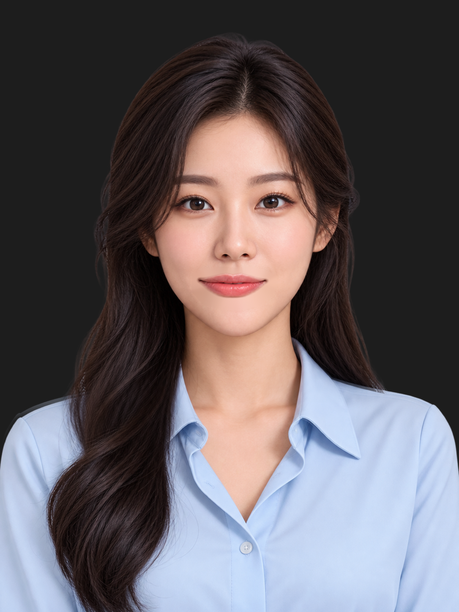

# Subtle Teacher motion

Head motion and breathing are authored in RML and compiled into `player/assets/teacher.riv`. The existing UI and character PNGs are preserved. Flutter supplies audio activity and the contained artboard size.

## Current motion

| Setting | Behavior |
| --- | --- |
| Pivot | Neck at artwork coordinate (544, 870) |
| Requested independent head ranges | Idle ±0.8°, talking at most ±1.2° |
| Active seam fallback | Shared head/body sway: idle ±0.35°, talking ±0.5° |
| Breathing translation | Up to ±2 logical pixels at the displayed size |
| Breathing scale | Uniform 1.002–1.004 around the neck |
| State changes | 700 ms cubic ease-in-out |
| Brief speech pauses | Hold the talking motion for up to 700 ms of quiet |
| Idle / talking / breathing timelines | 47 / 67 / 31 seconds, with varied key spacing and amplitudes |

The head PNG contains shoulder artwork that overlaps the torso PNG. At the requested independent tilt limits, that overlap exposes a doubled shoulder edge. The smaller whole-avatar sway rotates both layers together around the neck, preserving their registration. Eyes, mouth and foundation follow the same assembly. The classroom sits outside these transforms.

| Independent head tilt: visible shoulder overlap | Active shared sway: aligned shoulders |
| --- | --- |
|  |  |

Timing is deliberately uneven, with smooth direction changes and seamless loop boundaries. The timelines are deterministic and eventually repeat; their different lengths avoid a short synchronized head/breathing cycle. Motion state animations resume rather than explicitly resetting on every word.

## Display-size compensation

`AvatarController.configureViewport()` calculates the contain scale from the existing viewport:

```text
displayScale = min(viewportWidth / 1086, viewportHeight / 1448)
breathAmplitude = min(1, 0.25 / displayScale)
displayed breathing amplitude = 8 × breathAmplitude × displayScale
```

This yields 2 logical pixels at normal player sizes, and less at very small sizes. Logical pixels follow Flutter's display scaling.

Rive animates an offset of ±8 artwork units. A parent vertical gain and an inverse child gain scale only that offset; their image scaling cancels. This preserves facial aspect ratios. Uniform breathing scale is applied separately after the compensating transforms, with its origin at the neck.

The default CLI gain is 0.5, equivalent to ±2 px when the 1448 px artboard is displayed at 724 px high. Flutter updates the gain when the viewport changes. A standalone CLI preview does not receive Flutter viewport updates.

## Audio behavior

`motionTalking` follows real playback activity. Short quiet gaps keep the current talking gesture; longer silence returns to idle. Pause, completion and manual mouth inspection select idle immediately, with the visual transition eased in Rive. Seeking resets the quiet hold before sampling the new media position.

The mouth timeline, RMS envelope, silence gate and mouth crossfades are unchanged. Eye Auto/Open/Half controls remain independent. Rest, Wide and Closed eyes stay disabled.

## Authoring

`gettopik-teacher/tools/head_motion_rig.py` updates motion without rebuilding the mouth or eye rig. `build_scene.py` calls the same helper when recreating the complete scene. Its default enables the seam fallback.

```powershell
python gettopik-teacher/tools/head_motion_rig.py
rive gettopik-teacher --verify
rive inspect gettopik-teacher --summary
rive gettopik-teacher --once
Copy-Item gettopik-teacher/build/teacher.riv player/assets/teacher.riv -Force
```

The helper's `--separate-head` option enables the original ±0.8° / ±1.2° ranges for inspection if future artwork has a clean head/body split. The current supplied artwork should use the default fallback.

## Validation

- Rive verify/build and resolved inspection pass.
- Rendered full head tilt and fallback extremes were inspected at native artwork resolution.
- Image registration measures approximately 2 px and 6 px shifts between gains 0.25 → 0.5 and 0.25 → 1.0, matching the expected linear translation without an image-size change.
- Background regions remain pixel-identical across different animation times.
- Source PNG hashes and eye/mouth/audio animation tracks match the pre-motion version.
- The native integration test checks motion activity during real playback and pause, display-size breathing gain, mouth synchronization, silence, seeking, replay and eye controls.

[Measured motion report](../gettopik-teacher/validation/subtle-motion/motion-report.json) · [Native playback report](../gettopik-teacher/validation/subtle-motion/playback-report.json) · [Speaker output report](../gettopik-teacher/validation/subtle-motion/audio-output-report.json)
