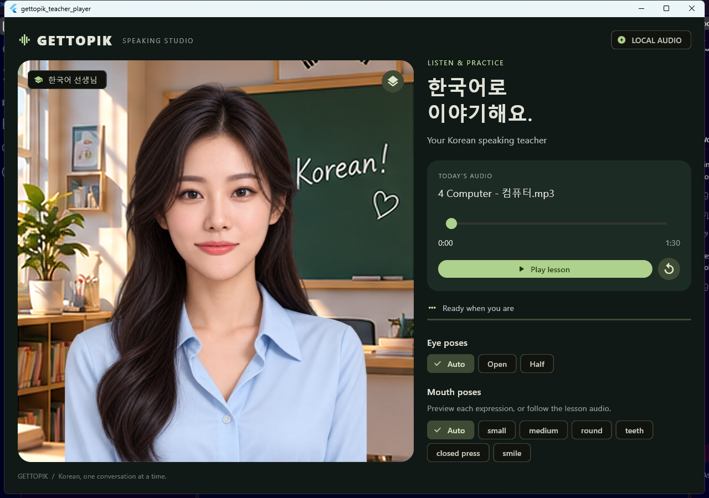

# Validation record

The current native Windows demo was tested after replacing Rest with Closed press. The screenshots below are actual application captures from that run.

The subsequent subtle-motion update preserves the eye, mouth and baked audio timelines. See the [motion validation](MOTION.md#validation) for the seam fallback, measured breathing offsets and its playback regression evidence.

## Verified behavior

| Check | Result |
| --- | --- |
| Rive CLI verification and build | Zero errors and warnings |
| Resolved project inspection | No reported problems |
| Default pose | Closed press; default render pixel-matches explicit index 6 |
| Compiled asset exclusions | Rest, Wide and Closed eyes absent |
| Audio timeline | Only indices 6, 1 and 2; zero silence violations |
| Native playback | Local recording played; speaker loopback output detected |
| Silence and pause | Closed press selected |
| Seeking and resume | Mouth sampled using the native media position |
| Completion and replay | Mouth closes; Play restarts from the beginning |
| Manual mouth inspection | All six active poses exercised |
| Legacy requests | Rest → Closed press; Wide → Medium |
| Eye controls | Open/Half holds, Auto restoration and independence from mouth/audio checked |
| Flutter static analysis | No issues found |
| Native integration test | Passed |

## Evidence

- [Playback report](../gettopik-teacher/validation/closed-press-default/playback-report.json): audio-clock samples, Rive values and scenario results.
- [Speaker loopback report](../gettopik-teacher/validation/closed-press-default/audio-output-report.json): measured native output during playback.
- [Rig report](../gettopik-teacher/validation/closed-press-default/rig-report.json): exclusions, silence mapping, default image comparison and audio hash.
- [Audio analysis](../gettopik-teacher/audio/analysis_report.json): duration, RMS settings and source/output hashes.
- [Integration test](../player/integration_test/playback_test.dart): executable checks behind this record.

| Audio playing | Audio paused |
| --- | --- |
|  |  |

The bundled WAV is 90.279208 seconds, mono PCM at 24 kHz. Its SHA-256 is `ad1638c10824e5ccaac4a08b43f34ebaf45818cb5c5f21a343f1595b60ec61b8`.

## Limits of the result

This validates amplitude-driven animation with real playback; it does not establish phoneme-accurate lip sync. The analyzer maps energy to three automatic states and cannot infer pronunciation from RMS alone.

Open → Half → Open is currently a partial blink because Closed eyes are disabled. Lip contours can still differ from the original portrait, the shared skin patch may look smoother at high magnification, and slight shoulder seams can appear during head movement. Native Windows is the tested target.

For rerun commands and speaker-loopback requirements, see [development checks](DEVELOPMENT.md#checks). Test output is generated locally and ignored; curated evidence and documentation images are retained in Git.
